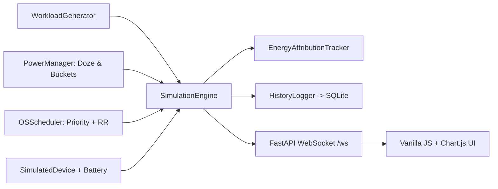

# PowerMonitorSim — OS Power Consumption & Activity Monitor

A local Operating Systems simulation that models a smartphone OS (processes, priority scheduler, DVFS, Doze mode, App Standby Buckets, wakelocks, and Li-ion battery physics) with an Android-style monitoring suite (`BatteryManager`, `UsageStatsManager`, energy attribution, SQLite history, anomaly detection, and a What-If policy optimizer).

## Quick Start (Windows)

```bat
run.bat
```

`run.bat` creates a local `venv`, installs `requirements.txt`, starts the FastAPI server at `http://localhost:8010`, and opens your browser.

## Architecture



## OS Concepts Demonstrated

- **Process States & Lifecycle:** `FOREGROUND`, `VISIBLE`, `SERVICE`, `BACKGROUND`, `CACHED`, `STOPPED`.
- **CPU Scheduling & Accounting:** Priority-weighted round-robin scheduler with `cpu_time_ms` and context-switch tracking.
- **DVFS:** Dynamic CPU frequency scaling (600–2400 MHz) based on runnable demand.
- **Doze & App Standby Buckets:** Automatic background throttling when screen is off or apps are `RARE` / `RESTRICTED`.
- **Wakelocks & Rogue App Detection:** Detects background apps holding wakelocks or draining power disproportionately.
- **Power Attribution:** Maps hardware component mA (`power_profile.xml` model) to individual processes.

## Screenshots

- *Live Monitor & Gauge:* `docs/screenshots/live.png` (placeholder)
- *Per-App Attribution:* `docs/screenshots/apps.png` (placeholder)
- *What-If Optimizer:* `docs/screenshots/optimizer.png` (placeholder)

## Running Tests

```bat
venv\Scripts\pytest.exe
```

